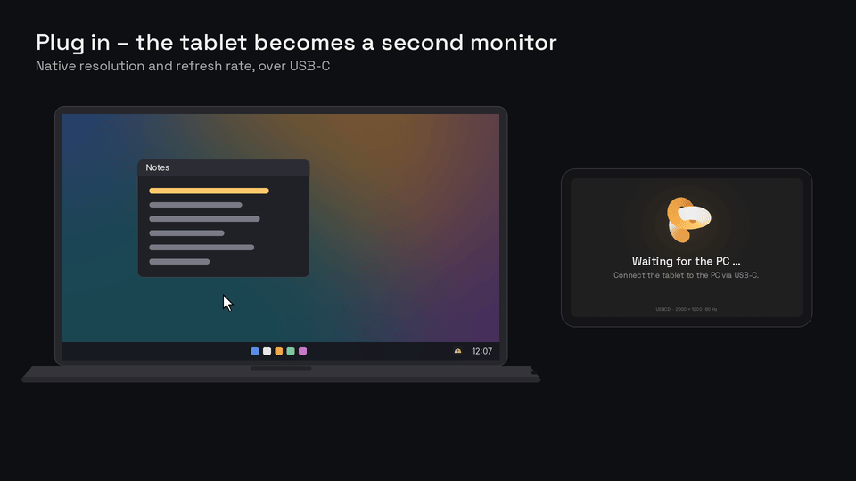
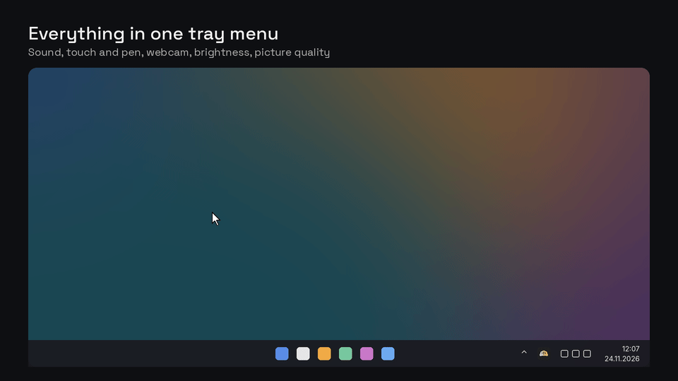
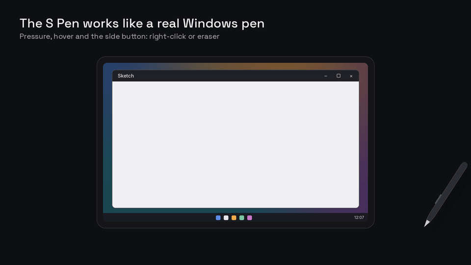
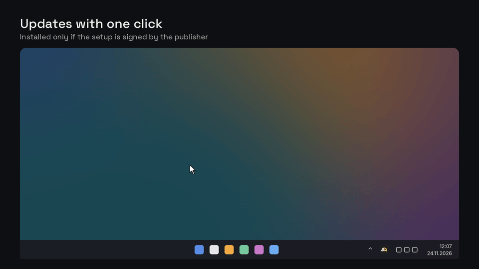

<p align="center">
  
</p>

# USBCD – Android-Tablet als zweiter Monitor mit Lautsprechern und Webcam (USB-C, Windows 11)

*English version: [README.md](README.md)*

Tablet per USB-C anstecken → Windows bekommt einen **neuen Monitor** mit der nativen Auflösung und der höchsten
Bildrate des Tablets. Dazu gibt es einen Ausgang **„USBCD Tablet Lautsprecher“**, den du in Windows wählen kannst.
Beim Abziehen verschwindet der Monitor wieder.

In den Windows-Anzeigeeinstellungen stehen zusätzlich kleinere Auflösungen im Seitenverhältnis des Tablets
(beim Tab S6 Lite 1600 × 960, 1280 × 768, 1000 × 600). Sie werden in dieser Größe übertragen und erst vom Tablet
hochgerechnet – das entlastet schwächere PCs. Für größere Schrift bleibt die Skalierung die schärfere Wahl.

<p align="center">
  
</p>

Sprache: Deutsch oder Englisch – Setup, Windows-Programm und Tablet-App richten sich nach der jeweiligen Systemsprache.

## Voraussetzungen

* Windows 11 (64 Bit)
* Android-Tablet ab Android 8.0 und ein USB-C-Datenkabel – entwickelt und getestet mit dem Samsung Galaxy Tab S6 Lite
* Empfohlen: Grafikkarte mit Hardware-Encoder (NVIDIA, AMD oder Intel). Ohne läuft es per Software, aber langsamer.

## Wie es funktioniert

Ein Android-Tablet kann sich am USB-C-Port technisch nicht als Monitor ausgeben: Der Port arbeitet nur als
USB-*Gerät* (MTP, ADB …) und hat keinen Bildeingang. Deshalb gibt es zwei Teile:

* **Windows (Rust, Symbol in der Taskleiste):** erkennt das Tablet, startet die App, legt einen echten virtuellen
  Monitor an ([Virtual Display Driver](https://github.com/VirtualDrivers/Virtual-Display-Driver)) mit Auflösung und
  Bildrate des Tablets, nimmt ihn mit FFmpeg auf und kodiert auf der Grafikkarte (NVENC / AMF / QSV). Ton, der über
  „USBCD Tablet Lautsprecher“ (VB-CABLE) läuft, wird abgegriffen und unkomprimiert gesendet.
* **Tablet-App (Kotlin):** wählt den höchsten Display-Modus, meldet Auflösung und Decoder-Fähigkeiten,
  dekodiert in Hardware mit niedriger Latenz, spielt den Ton ab.
* **Verbindung:** ADB über das USB-Kabel – kein WLAN nötig.

Der Standard-Ausgang für Ton wird **nicht** umgestellt. Für Ton übers Tablet in Windows „USBCD Tablet Lautsprecher“ wählen.

## Sicherheit

* **USBCD läuft ohne Administratorrechte** (Autostart über `HKCU\…\Run`). Was Rechte braucht – den virtuellen
  Monitor ein-/ausschalten, seinen Modus eintragen, den Lautsprecher benennen –, erledigt der Windows-Dienst
  **„USBCD Helper“**. Er nimmt über die lokale Leitung `\\.\pipe\USBCD-Helper` nur fest eingebaute Befehle mit
  geprüften Werten an, und nur von der installierten `USBCD.exe`. Keine Pfade, keine Skripte, kein PowerShell.
* **Gegenseitige Anmeldung PC ↔ Tablet:** Beim Start bekommt die App über adb ein zufälliges Geheimnis
  (nur im Arbeitsspeicher, gültig solange USBCD läuft). Jede Verbindung beginnt mit einem HMAC-SHA256-
  Challenge-Response in beide Richtungen. Eine fremde App, die den USBCD-Anschluss auf dem Tablet belegt,
  bekommt so kein Bild, und niemand kann der App ein falsches Bild unterschieben. Das Geheimnis nimmt die App
  nur über den Einstieg `.Connect` an, den allein die adb-Shell öffnen darf.
* **Abgesicherte Ordner:** `C:\VirtualDisplayDriver` (Treiber-Einstellungen) und `C:\ProgramData\USBCD`
  (Logs von Dienst und Setup) dürfen nur Administratoren ändern.
* **Geprüfte Downloads:** Das Setup prüft die Signatur von VB-CABLE (VB-Audio) vor dem Start. Der Build prüft
  die Signaturen von adb (Google) und Monitor-Treiber und merkt sich SHA-256-Prüfsummen in
  `installer\deps.lock.json` – ändert sich eine Datei unbemerkt, bricht der Build ab.
* **Tablet-App** mit eigenem Release-Schlüssel signiert (`installer\keys\`, beim ersten Bauen angelegt – **sichern
  und nicht weitergeben**). Eine anders signierte Fassung (z. B. aus Android Studio) ersetzt USBCD beim Anstecken.
* **Code-Signatur (optional):** Mit `USBCD_SIGN_CERT_THUMBPRINT` (Fingerabdruck eines Code-Signing-Zertifikats im
  Zertifikatspeicher) signiert der Build `USBCD.exe`, Setup und Deinstallation.
* **Updates nur vom Herausgeber:** USBCD installiert ein Update nur, wenn das Setup mit dem Update-Schlüssel des
  Projektinhabers unterschrieben ist (ECDSA P-256, geprüft von Windows selbst). Der öffentliche Teil ist in
  `USBCD.exe` eingebaut (`host/assets/update-key.pub`), der private liegt nur beim Herausgeber. Ein gefälschtes oder
  verändertes Setup – auch eins, das im GitHub-Projekt auftaucht – wird gelöscht statt gestartet.
* **USB-Debugging** gibt dem verbundenen PC weitreichenden Zugriff auf das Tablet. Nur an eigenen PCs
  „Immer zulassen“ wählen; fremde Freigaben unter *Entwickleroptionen → USB-Debugging-Autorisierungen aufheben*
  löschen.

## Datenschutz

USBCD sammelt keine Daten und schickt nichts an den Herausgeber oder an Dritte. Es gibt keine Telemetrie, keine Werbung und kein
Konto.

* **Bild, Ton, Touch, Stift und Webcam** laufen nur über das USB-Kabel zwischen PC und Tablet (über adb, auf beiden
  Seiten nur an `127.0.0.1`). Nichts davon geht ins Internet, nichts wird aufgezeichnet.
* **Einzige Verbindung ins Internet** ist die [Update-Prüfung](#updates) bei GitHub. GitHub sieht dabei wie bei
  jedem Webseitenaufruf deine IP-Adresse; dafür gilt die Datenschutzerklärung von GitHub. Ausschalten: Menü →
  *Automatisch nach Updates suchen*.
* **Webcam:** nur die Frontkamera und nur, wenn du *Selfie-Kamera des Tablets als Webcam* einschaltest. Die Bilder
  bekommt nur die App, in der du „USBCD Tablet Webcam“ auswählst.
* **Einstellungen und Log** (`usbcd.toml`, `usbcd.log`, `diagnose.txt`) liegen nur auf deinem PC unter
  `%LOCALAPPDATA%\USBCD`. Sie verlassen ihn nur, wenn du sie selbst weitergibst, z. B. in einem Issue.

## Einrichtung

### Tablet (einmalig)
1. Einstellungen → Tabletinfo → Softwareinformationen → 7× auf *Buildnummer* tippen.
2. Entwickleroptionen → **USB-Debugging** einschalten.
3. Samsung ab One UI 6: **Auto Blocker** ausschalten (Einstellungen > Sicherheit und Datenschutz > Auto Blocker).
   Solange er an ist, blockiert das Tablet Befehle über USB, und USBCD kann seine App weder installieren noch starten.

### Installieren
1. Die neueste **`USBCD-Setup-<version>.exe`** unter [Releases](../../releases/latest) herunterladen und ausführen.
   Das Setup erklärt vorab, was passiert; Windows fragt bis zu zweimal nach Treiber-Software
   (Monitor, VB-CABLE) – jeweils *Installieren*. Nach der ersten VB-CABLE-Installation einmal neu starten.
2. Tablet anstecken und „USB-Debugging zulassen?“ mit **„Immer von diesem Computer zulassen“** bestätigen.
   **Die App wird automatisch auf das Tablet übertragen** und bei neuen Versionen aktualisiert.

Wer das Setup selbst bauen möchte: siehe [Selbst bauen](#selbst-bauen).

## Bedienung

USBCD läuft als **Symbol im Infobereich der Taskleiste** (ggf. unter ^). Klick darauf öffnet das Menü:

<p align="center">
  
</p>

| Menüpunkt | Wirkung |
|---|---|
| Status | z. B. „Verbunden: Galaxy Tab S6 Lite · 2000×1200 · 60 Hz“ |
| Auf dem Tablet anzeigen | App öffnen, nachdem sie auf dem Tablet geschlossen wurde |
| Geräte | alle bekannten Geräte; Haken = als Bildschirm verwenden, Klick schaltet um. Neue Geräte stehen hier mit „Neu: … – als Bildschirm verwenden“ |
| Ton zum Tablet übertragen | Ton-Übertragung ein/aus |
| Touch und Stift am Tablet | Finger und S Pen bedienen Windows auf dem Tablet-Monitor (Standard: an) |
| Stiftdruck | Weich (wenig Kraft nötig) · Linear (Standard) · Hart (feiner bei leichtem Druck) |
| Seitentaste des Stifts | Rechtsklick (Standard, auch per Klick in der Luft) · Radierer, solange gedrückt |
| Info-Anzeige auf dem Tablet | Bilder/s, Datenrate, Dekodierzeit und USB-Laufzeit oben links (Standard: aus) |
| Tablet mit dem PC-Bildschirm aus- und einschalten | Geht der PC-Bildschirm aus oder wird der PC gesperrt, geht auch das Tablet-Display aus – und wieder an (Standard: an) |
| Selfie-Kamera des Tablets als Webcam | legt in Windows die Kamera „USBCD Tablet Webcam“ an (Standard: aus) – siehe unten |
| „Nicht stören“ auf dem Tablet, solange es Monitor ist | keine Benachrichtigungen über dem Bild; danach wie vorher. Braucht einmal die Erlaubnis auf dem Tablet (Standard: aus) |
| Lautstärketasten des Tablets regeln den Tablet-Lautsprecher | die Tasten am Tablet stellen „USBCD Tablet Lautsprecher“ in Windows lauter/leiser, mit Anzeige auf dem Tablet (Standard: an) |
| Tablet ausschalten (Bild und Ton) | Tablet-Monitor weg, Tablet-Display aus, ohne das Kabel zu ziehen; derselbe Menüpunkt schaltet wieder ein |
| Bildqualität | Sparsam (10 Mbit/s) · Standard (automatisch) · Hoch (40 Mbit/s) · Maximal (gleichbleibende Qualität) – dazu *Standbilder verlustfrei*, siehe [Farbtreue](#farbtreue) |
| Tablet-Helligkeit | 100 % · 75 % · 50 % · 25 % – wirkt sofort |
| Soundeinstellungen / Anzeigeeinstellungen | öffnet die Windows-Einstellungen |
| Einstellungen und Log öffnen | Ordner mit `usbcd.toml` und `usbcd.log` |
| Beim Anmelden automatisch starten | Autostart ein/aus |
| Update auf … installieren | erscheint, sobald es eine neue Version gibt – siehe [Updates](#updates) |
| Automatisch nach Updates suchen | sieht kurz nach dem Start und danach täglich bei GitHub nach (Standard: an) |
| Über USBCD … | Version, Lizenz und Gewährleistungsausschluss; öffnet auf Wunsch die Lizenztexte |
| USBCD beenden | |

**Verhalten:**
* **Neues Gerät:** USBCD installiert oder startet nichts ungefragt. Es erscheint die Benachrichtigung „Neues Gerät
  erkannt“ mit *Als Bildschirm verwenden* und *Nie für dieses Gerät*. Ignorierst du sie, passiert nichts. Die Antwort
  gilt dauerhaft für dieses Gerät und ist im Menü unter *Geräte* änderbar. Geräte, auf denen die USBCD-App schon
  installiert ist, gelten als zugelassen. Emulatoren und WLAN-Debugging werden nie angefasst.
* Bei zugelassenen Geräten öffnet sich die App beim Anstecken automatisch; Windows meldet „Tablet verbunden“.
* Benachrichtigungen kommen von „USBCD“ mit Logo; Statusmeldungen leise, Fehler mit Ton und „Log öffnen“.
* **Hintergrundbild:** Windows verliert beim Hinzufügen/Entfernen virtueller Monitore gern das Hintergrundbild
  (schwarzer Desktop). USBCD merkt sich vorher das Bild jedes Bildschirms und setzt es danach wieder; der
  Tablet-Monitor bekommt das Bild des Hauptbildschirms. Diashow, Windows-Blickpunkt und einfarbige Hintergründe
  bleiben unangetastet.
* Schließt du die App, bleibt sie zu – fortsetzen über *Auf dem Tablet anzeigen* oder die App selbst öffnen.
* Kurze USB-Aussetzer werden in ~2 s still überbrückt; der Monitor bleibt bestehen.
* Ohne Verbindung zeigt das Tablet einen ruhigen, animierten Hintergrund mit Status – nie das eingefrorene letzte Bild.
* Probleme (USB-Debugging nicht erlaubt, App fehlt, Übertragungsfehler) meldet Windows mit dem nächsten Schritt.
* Die Lautstärke des Tablets wird nicht verändert.

<p align="center">
  
</p>

**Touch und S Pen:** Der Stift kommt in Windows als echter Stift an – mit Druckstufen, Schweben (der Mauszeiger
folgt dem Stift, ohne zu klicken), Seitentaste und, falls der Stift sie meldet, Neigung. Das gilt für
alle Programme, die Windows-Stifteingabe („Windows Ink“) nutzen, z. B. Affinity, Krita, Photoshop, OneNote, Browser.
Finger tippen, ziehen und scrollen wie auf einem Touch-Bildschirm. Liegt beim Zeichnen der Handballen auf, werden
Finger bis kurz nach dem Absetzen des Stifts ignoriert.
* Programme, die nur den alten WinTab-Treiber kennen, bekommen keinen Druck (dafür bräuchte es einen Treiber).
* Fenster, die mit Administratorrechten laufen, lassen sich von Windows aus Sicherheitsgründen nicht per Touch/Stift
  bedienen (z. B. Benutzerkontensteuerung).
* Was die Seitentaste macht, stellst du unter *Seitentaste des Stifts* ein:
  * **Rechtsklick** (Standard): Taste halten und tippen, wie unter Windows üblich, oder einfach klicken, während der
    Stift schwebt.
  * **Radierer, solange gedrückt**: Mit gehaltener Taste radiert der Stift, wie das Radierer-Ende am Surface Pen.
    Umgeschaltet wird beim Schweben, nie mitten im Strich.
* Samsung öffnet beim Drücken der S-Pen-Taste im Schweben „Air Command“. Soll die Taste nur in Windows wirken,
  schaltest du das unter *Einstellungen → Erweiterte Funktionen → S Pen → Air Command* ab.

**Webcam:** Mit *Selfie-Kamera des Tablets als Webcam* erscheint in Windows 11 die Kamera „USBCD Tablet Webcam“.
Du wählst sie in der jeweiligen App selbst aus (Teams, Discord, Zoom, Browser, Windows-Kamera-App) – USBCD macht sie
nie zur Standardkamera und benutzt ausschließlich die Frontkamera, nie die Rückkamera.
* Die Kamera des Tablets läuft nur, während eine App die Webcam wirklich benutzt (Android zeigt dann den grünen
  Kamera-Punkt). Sonst ist sie aus.
* Beim ersten Einschalten fragt das Tablet einmal „Kamerazugriff erlauben?“.
* Ohne Bild (Tablet nicht verbunden, ausgeschaltet, Zugriff verweigert) zeigt die Webcam ein Hinweisbild.
* Bild: 1280×720, bis 30 Bilder/s. Die Kamera existiert nur, solange USBCD läuft, und nur für deinen Windows-Benutzer.
* Microsoft Teams ist bei virtuellen Kameras allgemein wählerisch (auch bei OBS & Co.). Klappt es dort nicht, liegt
  das an Teams; in Discord, Zoom und im Browser sollte die Webcam normal laufen.

**Tablet-Display mit dem PC:** Das Display geht wirklich aus (nicht nur dunkel) und kommt beim Aufwecken bzw.
Entsperren des PCs von selbst wieder. Bild und Ton laufen in der Zeit weiter; der Tablet-Monitor bleibt in Windows,
deine Fenster bleiben also, wo sie sind. Ist am Tablet eine Displaysperre eingerichtet, erscheint USBCD trotzdem
direkt über dem Sperrbildschirm.

## Updates

USBCD sieht kurz nach dem Start und danach einmal täglich im GitHub-Projekt nach, ob es eine neue Version gibt.
Wenn ja, erscheint eine Benachrichtigung mit **Jetzt aktualisieren** und **Diese Version überspringen**. Im Menü
steht dann **Update auf … installieren** – auch wenn die Benachrichtigung übersprungen wurde.

<p align="center">
  
</p>

* Installiert wird nur nach deinem Klick. USBCD lädt das Setup und seine Signaturdatei, prüft die Unterschrift und
  startet erst dann das Setup; Windows fragt wie bei jeder Installation nach Administratorrechten. Programm und
  Tablet-App werden aktualisiert, deine Einstellungen bleiben.
* Gesendet wird nichts außer der Anfrage selbst – GitHub sieht wie bei jedem Webseitenaufruf deine IP-Adresse.
  Ausschalten: Menü → *Automatisch nach Updates suchen*.
* Vorabversionen (z. B. `build-deps-…` mit den Dateien zum Bauen) werden nie angeboten.

## Weitere Einstellungen

`%LOCALAPPDATA%\USBCD\usbcd.toml` (Menü → *Einstellungen und Log öffnen*). Die wichtigsten Werte stellt das Menü ein.

| Schlüssel | Standard | Bedeutung |
|---|---|---|
| `encoder` | `"auto"` | `nvenc` / `amf` / `qsv` / `software` |
| `codec` | `"auto"` | `hevc` / `avc` |
| `bitrate_mbps` | `0` | 0 = automatisch (20–80 Mbit/s) |
| `max_fps` | `0` | 0 = Tablet-Maximum |
| `tablet_brightness` | `100` | Helligkeit des Tablets in % |
| `audio_enabled` | `true` | Ton übertragen |
| `audio_device_rename` | `"USBCD Tablet Lautsprecher"` | Name des Lautsprechers in Windows (englisches Windows: „USBCD Tablet Speakers“) |
| `auto_switch_audio` | `false` | Tablet-Lautsprecher beim Anstecken automatisch zum Standard machen |
| `volume_mode` | `"auto"` | `manual` / `off`, falls die Windows-Lautstärke doppelt bzw. gar nicht wirkt |
| `hide_cable_output` | `true` | Aufnahmeseite „CABLE Output“ ausblenden (Programme können den Tablet-Ton dann nicht als Mikrofon aufnehmen) |
| `display_position` | – | Wird automatisch gemerkt, wenn du den Tablet-Monitor in den Windows-Anzeigeeinstellungen verschiebst; Zeile löschen = wieder „rechts neben dem Hauptbildschirm“ |
| `tablet_input` | `true` | Touch und S Pen steuern Windows (auch im Menü) |
| `pen_pressure` | `"linear"` | Druckkurve des S Pen: `soft` / `linear` / `hard` (auch im Menü) |
| `pen_button` | `"right_click"` | Seitentaste des S Pen: `right_click` / `eraser` (auch im Menü) |
| `show_stats` | `false` | Info-Anzeige auf dem Tablet (auch im Menü) |
| `follow_pc_power` | `true` | Tablet-Display mit dem PC-Bildschirm aus/an (auch im Menü) |
| `webcam` | `false` | Selfie-Kamera des Tablets als Webcam (auch im Menü) |
| `tablet_dnd` | `false` | „Nicht stören“ auf dem Tablet, solange es Monitor ist (auch im Menü) |
| `tablet_volume_keys` | `true` | Lautstärketasten des Tablets regeln den Tablet-Lautsprecher (auch im Menü) |
| `sparse_frames` | `true` | Bilder nur bei Änderungen senden – nur bei Tablets, deren Dekoder jedes Bild sofort ausgibt (prüft die App selbst); spart Grafikkarte, USB und Tablet-Akku |
| `quality_max` | `false` | Bildqualität *Maximal* (auch im Menü) |
| `lossless_stills` | `false` | Standbilder verlustfrei (auch im Menü) |
| `stream_priority` | `true` | Vorrang für die Bildübertragung: Grafikchip „hoch“, CPU „höher als normal“ für FFmpeg; `false`, falls ein anderes Programm (z. B. ein Spiel oder Parsec) darunter leidet |
| `update_check` | `true` | Kurz nach dem Start und täglich nach einer neuen Version sehen (auch im Menü) |
| `update_skip` | `""` | Diese Version nicht mehr per Benachrichtigung anbieten (wird von „Diese Version überspringen“ gesetzt) |

## Farbtreue

Für Gestaltungsarbeit zählt vor allem, wie genau die Farben ankommen:

* **Farbumrechnung:** USBCD rechnet das Bild mit einer festen Farbmatrix um und vermerkt sie im
  Video – das Tablet dekodiert die Farben so, wie sie gemeint sind.
* **Bildqualität → Maximal:** gleichbleibende Qualität statt gleichbleibender Datenrate (NVIDIA;
  andere Grafikchips nutzen die höchste Datenrate). Braucht mehr Daten – über USB kein Problem – und
  bei großen Änderungen wenige Millisekunden mehr Verzögerung. Gedacht für starke PCs.
* **Standbilder verlustfrei** (Menü *Bildqualität*): Steht das Bild kurz still, schickt USBCD ein
  pixelgenaues Bild hinterher – exakte Farbwerte, volle Farbauflösung (kein Farbsaum an roter oder
  blauer Schrift), keine Kompressionsspuren. Sobald sich etwas bewegt, übernimmt wieder das normale
  Video. Nur, wenn der Tablet-Monitor in der nativen Auflösung des Tablets läuft. Blinkt etwas
  dauerhaft (z. B. ein Text-Cursor), pausieren die Standbilder, damit das Bild nicht ständig zwischen
  scharf und weich wechselt. Kostet am PC etwas Rechenzeit – gedacht für starke PCs.
* **Farbprofil:** Das Panel des Tablets ist ab Werk nicht kalibriert. Mit einem Messgerät lässt es
  sich vermessen (z. B. mit [DisplayCAL](https://displaycal.net/)) und das Profil in Windows dem
  Tablet-Monitor zuordnen (*Farbverwaltung*). Farbverwaltete Programme (Photoshop, Affinity, Krita,
  Browser) zeigen dann genaue Farben. **Nur ein Profil** erstellen, ohne Kalibrierkurven – die wendet
  Windows auf einem virtuellen Monitor möglicherweise nicht an. Die Zuordnung bleibt, weil der
  Tablet-Monitor jedes Mal mit derselben Kennung erscheint.
* Am Tablet für Farbarbeit Blaulichtfilter ausschalten (Samsung: *Augenkomfort* bzw. *Blaulichtfilter*).

## Tipps für schwache Laptops

Laptops ohne eigene Grafikkarte teilen einen Grafikchip zwischen Desktop, Browser, Aufnahme und
Kodierung. USBCD gibt seiner Übertragung selbst Vorrang (`stream_priority`). Außerdem hilft:

* **Netzteil anschließen.** Auf dem Akku laufen Windows und der Grafikchip langsamer. Einstellungen →
  System → Energie → *Energiemodus: Beste Leistung*.
* **Intel-Grafik:** Im Intel Graphics Command Center (Intel Graphics Software) gibt es getrennte
  Energiepläne für Akku und Netzbetrieb.
* **Kleinere Auflösung** für den Tablet-Monitor in den Windows-Anzeigeeinstellungen (z. B. 1600 × 960)
  – das Tablet rechnet sie hoch.
* **Weniger Effekte:** Transparenzeffekte und Animationen in Windows kosten ebenfalls Grafikleistung
  (Einstellungen → Barrierefreiheit → Visuelle Effekte).

## Fehlersuche

Alles steht in `usbcd.log` (Menü → *Einstellungen und Log öffnen*). Startmenü → **USBCD – Diagnose** sammelt alle
wichtigen Angaben in `diagnose.txt`. Dienst und Setup protokollieren nach `C:\ProgramData\USBCD`.

* **„Hilfsdienst fehlt“:** Setup erneut ausführen (*Dienste* → „USBCD Helper“ muss *Wird ausgeführt* zeigen).
* **„Sicherheitswarnung: Eine andere App … gibt sich als USBCD aus“:** Unbekannte Apps auf dem Tablet prüfen und
  das Tablet neu starten. Das Tablet zeigt in diesem Fall „Verbindung blockiert“.

* **Bild kommt nicht / bricht ab:** Menü → *Bildqualität → Sparsam* testen; sonst `encoder = "software"` in `usbcd.toml`.
* **Monitor erscheint nicht:** Im Geräte-Manager unter *Grafikkarten* muss „Virtual Display Driver“ stehen
  (ohne Tablet absichtlich deaktiviert).
* **Kein Ton:** Ist in Windows „USBCD Tablet Lautsprecher“ gewählt und *Ton zum Tablet übertragen* an?
* **App lässt sich nicht installieren:** Meldung beachten; ggf. alte App auf dem Tablet deinstallieren.
* **Samsung-Tablet wird nicht erkannt oder die App startet nicht:** Prüfen, ob Auto Blocker an ist
  (Einstellungen > Sicherheit und Datenschutz > Auto Blocker). Er blockiert Befehle über USB, also ausschalten.

**Deinstallieren:** *Einstellungen → Apps → USBCD*. Entfernt Programm, Hilfsdienst, Monitor-Gerät samt
Treiberpaket, Autostart, Startmenü-Einträge, Einstellungen, Logs (`%LOCALAPPDATA%\USBCD`, `C:\ProgramData\USBCD`)
und `C:\VirtualDisplayDriver`. Es fragt, ob auch VB-CABLE und die App auf dem angeschlossenen Tablet weg sollen;
bleibt VB-CABLE, wird es auf den Auslieferungszustand zurückgesetzt. Parsec und andere virtuelle Monitore bleiben
unberührt. Bewusst erhalten bleiben: der adb-Schlüssel `%USERPROFILE%\.android` (teilt sich USBCD mit Android
Studio) und der Quellcode-Ordner samt `installer\keys\`.

## Grenzen

* USB-Debugging muss an bleiben.
* Latenz typisch 1–3 Bilder – gut für Büro, Video und die meisten Spiele.
* Ein Tablet gleichzeitig; Druckstufen nur in Programmen mit Windows-Stifteingabe (nicht WinTab).
* Windows-Menüs und -Benachrichtigungen verwenden die Systemschrift (Space Grotesk nur in der Tablet-App).

## Selbst bauen

**Benötigt:**
* [Rust](https://rustup.rs) (stable) – samt „Visual Studio C++ Build Tools“, deren Installation der Rust-Installer anbietet.
* [Android Studio](https://developer.android.com/studio) – bringt Android-SDK und Java 17 mit. Den Ordner `android` einmal öffnen und synchronisieren.
* [Inno Setup](https://jrsoftware.org/isinfo.php) 6.6 oder neuer – fehlt es, installiert das Build-Skript es per winget.

**Bauen:**
1. Im Ordner `installer` auf **`Setup bauen.cmd`** doppelklicken. Das Skript baut das Windows-Programm **und die
   Tablet-App**, lädt beim ersten Mal FFmpeg, adb und den Monitor-Treiber und erzeugt
   **`installer\Output\USBCD-Setup-<version>.exe`**. Bei Fehlern bleibt das Fenster offen (Protokoll: `installer\build.log`).
   Wurde das Projekt als ZIP heruntergeladen, fragt Windows eventuell einmal, ob das Skript trotzdem ausgeführt werden
   soll – das ist bei heruntergeladenen Skripten normal.
2. Beim ersten Bauen entsteht in `installer\keys\` ein eigener Signaturschlüssel für die Tablet-App. **Sichern und nie
   hochladen** (steht in `.gitignore`). Selbst gebaute Apps sind damit anders signiert als die aus den Releases; beim
   Wechsel ersetzt USBCD die App auf dem Tablet.
3. **Updates signieren kann nur der Projektinhaber.** Ohne seinen Update-Schlüssel entsteht ein Setup ohne
   Signaturdatei – es lässt sich normal installieren, wird aber nie als Update angeboten. Wer eine eigene Fassung mit
   eigenen Updates verteilen möchte, schreibt `none` in `host\assets\update-key.pub`; der nächste Build legt dann
   einen eigenen Update-Schlüssel an (Sicherung: `installer\keys\update-signing-backup.txt` – in einen
   Passwortmanager übernehmen und die Datei löschen). Zu jedem Release gehören dann Setup **und** `.sig`-Datei.

Die Fremdprogramme (FFmpeg, adb, Monitor-Treiber) liegen nicht im Repository. Das Build-Skript lädt sie in festen
Versionen – FFmpeg und adb aus dem Release [build-deps-1](../../releases/tag/build-deps-1), den Monitor-Treiber aus
seinem eigenen Projekt –, prüft ihre Signaturen und vergleicht sie mit den Prüfsummen in `installer\deps.lock.json`.
So baut jeder mit exakt denselben Dateien.
Fehlt Android Studio oder wurde der Ordner `android` nie synchronisiert, entsteht das Setup trotzdem, aber **ohne
Tablet-App** – das Skript warnt dann. Die Tablet-App lässt sich auch direkt über Android Studio installieren
(Ordner `android` öffnen → ▶ Run).

## Aufbau

```
docs/       Animationen für diese README
android/    Android-Studio-Projekt (Kotlin, keine Fremdbibliotheken)
            MainActivity (Wartebildschirm, Helligkeit), GradientBackground, Fonts,
            DisplayInfo, StreamServer, VideoDecoder, AudioPlayer, Proto, Auth
            res/values (Englisch), res/values-de (Deutsch), adaptives Icon mit Monochrom-Ebene
host/       Rust: main (Geräte-Schleife, App-Installation), tray (Menü), session, helper (Dienst
            und Zugang), auth (Anmeldung), vdd, display, driver, video, still (verlustfreie
            Standbilder), nal, audio, autostart, i18n, config, proto, adb, util
installer/  Setup bauen.cmd · build-installer.ps1 · USBCD.iss (de/en) · setup-helper.ps1 · diagnose.ps1
            · deps.lock.json (Prüfsummen) · Erklärseiten · THIRD-PARTY.txt
```

## Mitmachen

Fehler und Ideen gern als [Issue](../../issues). Bei Fehlern hilft die Datei `diagnose.txt` (Startmenü →
**USBCD – Diagnose**) oder `usbcd.log` – vor dem Hochladen kurz durchsehen, ob etwas Persönliches drinsteht.
Pull Requests sind willkommen; alle sichtbaren Texte gibt es auf Deutsch und Englisch.

## Lizenz

Copyright © 2026 Samuel E. Ramirez. USBCD ist freie Software unter der
[GNU General Public License v3.0 oder später](LICENSE) und wird ohne jede Gewährleistung bereitgestellt, soweit das
Gesetz es zulässt. Zustimmen musst du der Lizenz nicht, um USBCD zu benutzen. Fremdkomponenten (FFmpeg, adb, Virtual Display Driver,
Space Grotesk, VB-CABLE, Rust-Bibliotheken) und ihre Lizenzen: [installer/THIRD-PARTY.txt](installer/THIRD-PARTY.txt).

Samsung, Galaxy, Android, Windows und weitere genannte Namen sind Marken ihrer Inhaber. USBCD ist ein unabhängiges
Projekt und steht in keiner Verbindung zu diesen Unternehmen.
