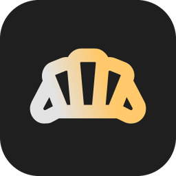
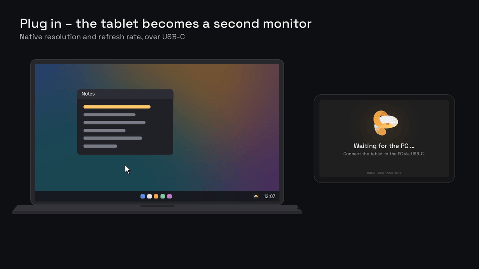
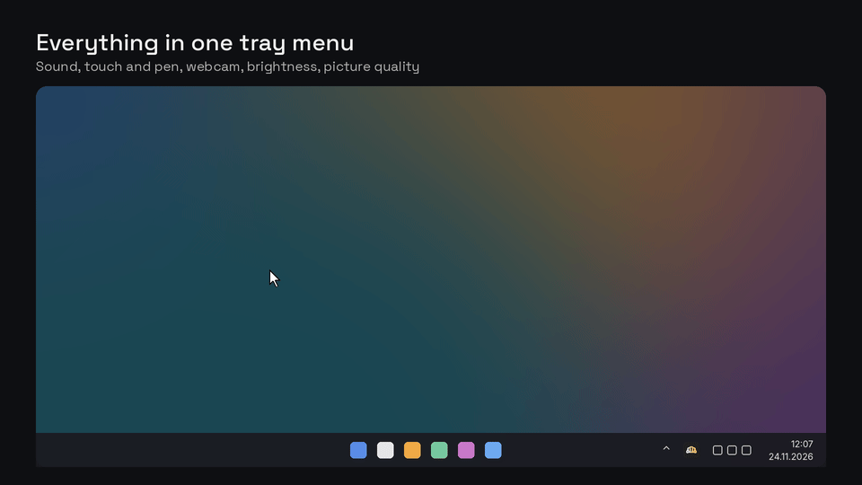
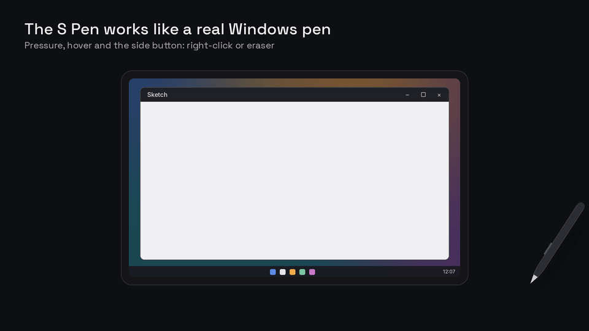
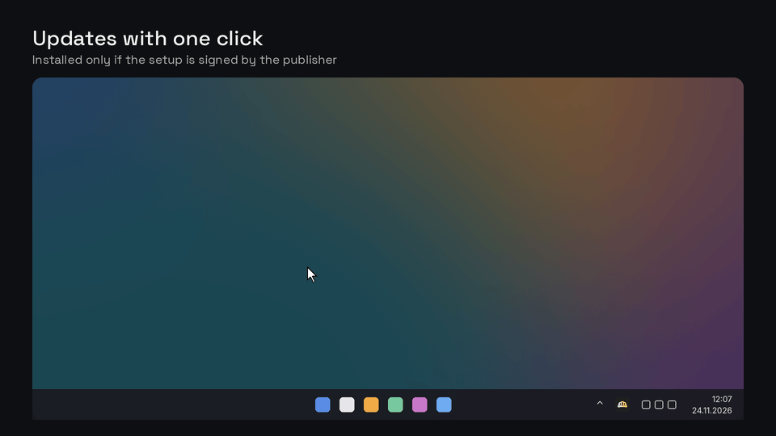

<p align="center">
  
</p>

# USBCD – Android tablet as a second monitor with speakers and webcam (USB-C, Windows 11)

*Deutsche Version: [README.de.md](README.de.md)*

Connect the tablet via USB-C → Windows gets a **new monitor** with the tablet's native resolution and highest
refresh rate. There is also an output **"USBCD Tablet Speakers"** that you can choose in Windows.
When you unplug the tablet, the monitor disappears again.

Windows display settings also offer smaller resolutions in the tablet's aspect ratio (Tab S6 Lite: 1600 × 960,
1280 × 768, 1000 × 600). They are transmitted at that size and upscaled by the tablet – easier on weaker PCs.
For larger text, scaling stays the sharper choice.

<p align="center">
  
</p>

Language: English or German – setup, Windows program and tablet app follow the respective system language.

## Requirements

* Windows 11 (64-bit)
* Android tablet with Android 8.0 or newer and a USB-C data cable – developed and tested with the Samsung Galaxy Tab S6 Lite.
  Weaker tablets work too: USBCD adapts resolution and frame rate to what their chip can handle.
* Recommended: a GPU with a hardware encoder (NVIDIA, AMD or Intel). Without one it falls back to software, which is slower.

## How it works

An Android tablet cannot present itself as a monitor on its USB-C port: the port only works as a USB *device*
(MTP, ADB …) and has no video input. That's why there are two parts:

* **Windows (Rust, taskbar icon):** detects the tablet, starts the app, creates a real virtual monitor
  ([Virtual Display Driver](https://github.com/VirtualDrivers/Virtual-Display-Driver)) with the tablet's resolution
  and refresh rate, captures it with FFmpeg and encodes it on the GPU (NVENC / AMF / QSV). Sound played on
  "USBCD Tablet Speakers" (VB-CABLE) is captured and sent uncompressed.
* **Tablet app (Kotlin):** picks the highest display mode, reports its resolution and what each decoder can handle
  at which size, decodes in hardware with low latency, plays the sound.
* **Connection:** ADB over the USB cable – no Wi-Fi needed.

If a tablet can't handle its full resolution (e.g. chips that only decode up to 1080p), USBCD streams at the largest
step it can handle and the tablet scales it up to its display; Windows keeps the full resolution. Priority:
hardware decoder before software, full frame rate at no less than about 80 % of the edge length, otherwise the
highest resolution with at least 30 frames/s, otherwise whatever works. If a step fails while running, USBCD moves
to the next one right away and remembers this for that tablet.

The default sound output is **not** changed. For sound on the tablet, choose "USBCD Tablet Speakers" in Windows.

## Security

* **USBCD runs without administrator rights** (autostart via `HKCU\…\Run`). The few things that need rights –
  switching the virtual monitor on/off, setting its mode, naming the speaker – are done by the Windows service
  **"USBCD Helper"**. Over the local pipe `\\.\pipe\USBCD-Helper` it accepts only fixed, built-in commands with
  checked values, and only from the installed `USBCD.exe`. No paths, no scripts, no PowerShell.
* **Mutual sign-in PC ↔ tablet:** on launch the app receives a random secret via adb (kept in memory only, valid
  while USBCD runs). Every connection starts with an HMAC-SHA256 challenge-response in both directions. Another app
  occupying the USBCD port on the tablet therefore gets no picture, and nobody can feed the app a fake picture.
  The app accepts the secret only through the `.Connect` entry point, which only the adb shell may open.
* **Protected folders:** `C:\VirtualDisplayDriver` (driver settings) and `C:\ProgramData\USBCD` (service and
  setup logs) can only be changed by administrators.
* **Checked downloads:** the setup verifies VB-CABLE's signature (VB-Audio) before running it. The build verifies
  the signatures of adb (Google) and the monitor driver and pins SHA-256 checksums in `installer\deps.lock.json` –
  if a file changes unnoticed, the build stops.
* **Tablet app** signed with its own release key (`installer\keys\`, created on the first build – **back it up and
  keep it private**). A differently signed copy (e.g. from Android Studio) is replaced by USBCD when connecting.
* **Code signing (optional):** with `USBCD_SIGN_CERT_THUMBPRINT` (thumbprint of a code-signing certificate in the
  certificate store) the build signs `USBCD.exe`, the setup and the uninstaller.
* **Updates only from the publisher:** USBCD installs an update only if the setup is signed with the project owner's
  update key (ECDSA P-256, verified by Windows itself). The public part is built into `USBCD.exe`
  (`host/assets/update-key.pub`); the private part stays with the publisher. A forged or modified setup – even one
  that shows up in the GitHub project – is deleted instead of run.
* **USB debugging** gives the connected PC far-reaching access to the tablet. Choose "Always allow" only on your own
  PCs and remove other authorizations under *Developer options → Revoke USB debugging authorizations*.

## Privacy

USBCD collects no data and sends nothing to the publisher or anyone else. There is no telemetry, no advertising and
no account.

* **Picture, sound, touch, pen and webcam** only travel over the USB cable between PC and tablet (via adb, only on
  `127.0.0.1` on both sides). None of it goes to the internet, nothing is recorded.
* **The only internet connection** is the [update check](#updates) on GitHub. Like any website visit, GitHub sees
  your IP address; GitHub's privacy statement applies to that. To turn it off: menu → *Check for updates
  automatically*.
* **Webcam:** only the front camera and only when you turn on *Tablet selfie camera as webcam*. Only the app in which
  you choose "USBCD Tablet Webcam" gets the pictures.
* **Settings and log** (`usbcd.toml`, `usbcd.log`, `diagnose.txt`) stay on your PC under `%LOCALAPPDATA%\USBCD`.
  They only leave it if you pass them on yourself, e.g. in an issue.

## Setup

### Tablet (once)
1. Settings → About tablet → Software information → tap *Build number* 7 times.
2. Developer options → turn on **USB debugging**.
3. Samsung with One UI 6 or newer: turn off **Auto Blocker** (Settings > Security and privacy > Auto Blocker).
   While it is on, the tablet blocks commands over USB, so USBCD cannot install or start its app.

### Install
1. Download the latest **`USBCD-Setup-<version>.exe`** from [Releases](../../releases/latest) and run it.
   It explains what will happen; Windows asks up to twice about driver software
   (monitor, VB-CABLE) – click *Install* each time. Restart once after the first VB-CABLE installation.
2. Connect the tablet and confirm "Allow USB debugging?" with **"Always allow from this computer"**.
   **The app is transferred to the tablet automatically** and updated with new versions.

To build the setup yourself, see [Building from source](#building-from-source).

## Usage

USBCD runs as an **icon in the notification area** (possibly under ^). Click it to open the menu:

<p align="center">
  
</p>

| Menu item | Effect |
|---|---|
| Status | e.g. "Connected: Galaxy Tab S6 Lite · 2000×1200 · 60 Hz" |
| Show on tablet | open the app again after it was closed on the tablet |
| Devices | all known devices; check mark = use as screen, click toggles. New devices appear as “New: … – use as screen” |
| Send sound to tablet | sound transmission on/off |
| Touch and pen on the tablet | fingers and S Pen operate Windows on the tablet monitor (default: on) |
| Pen pressure | Soft (little force needed) · Linear (default) · Firm (finer at light pressure) |
| Pen side button | Right-click (default, also by clicking in the air) · Eraser while held |
| Info overlay on the tablet | frames/s, data rate, decode time and USB round trip at the top left (default: off) |
| Turn tablet off and on with the PC screen | when the PC screen turns off or the PC is locked, the tablet display turns off too – and back on (default: on) |
| Tablet selfie camera as webcam | adds the camera “USBCD Tablet Webcam” to Windows (default: off) – see below |
| “Do not disturb” on the tablet while it is a monitor | no notifications over the picture; afterwards as before. Needs a one-time permission on the tablet (default: off) |
| Tablet volume buttons control the tablet speakers | the tablet buttons turn “USBCD Tablet Speakers” in Windows up/down, shown on the tablet (default: on) |
| Switch tablet off (picture and sound) | removes the tablet monitor and turns the tablet display off without unplugging; the same item switches it back on |
| Picture quality | Data saver (10 Mbit/s) · Standard (automatic) · High (40 Mbit/s) · Maximum (constant quality) – plus *Lossless still images*, see [Colour accuracy](#colour-accuracy) |
| Tablet brightness | 100 % · 75 % · 50 % · 25 % – applies immediately |
| Sound settings / Display settings | opens the Windows settings |
| Open settings and log | folder with `usbcd.toml` and `usbcd.log` |
| Start automatically at sign-in | autostart on/off |
| Install update … | appears as soon as a new version is out – see [Updates](#updates) |
| Check for updates automatically | checks GitHub shortly after start and then daily (default: on) |
| About USBCD … | version, license and warranty disclaimer; opens the license texts if you like |
| Quit USBCD | |

**Behaviour:**
* **New device:** USBCD installs or starts nothing without asking. A "New device detected" notification offers
  *Use as screen* and *Never for this device*. If you ignore it, nothing happens. The answer is remembered for this
  device and can be changed in the menu under *Devices*. Devices that already have the USBCD app count as allowed.
  Emulators and wireless debugging are never touched.
* For allowed devices the app opens automatically when connected; Windows shows "Tablet connected".
* Notifications come from "USBCD" with its logo; status messages are silent, errors play a sound and offer "Open log".
* **Wallpaper:** Windows often loses the wallpaper when virtual monitors are added or removed (black desktop). USBCD
  remembers each screen's picture beforehand and sets it again afterwards; the tablet monitor gets the main screen's
  picture. Slideshows, Windows Spotlight and solid-colour backgrounds are left alone.
* If you close the app, it stays closed – continue via *Show on tablet* or open the app yourself.
* Short USB dropouts are bridged silently in ~2 s; the monitor stays.
* Without a connection the tablet shows a calm animated background with status – never the frozen last frame.
* Problems (USB debugging not allowed, app missing, transmission errors) are reported by Windows with the next step.
* The tablet's volume is not changed.

<p align="center">
  
</p>

**Touch and S Pen:** the pen arrives in Windows as a real pen – with pressure, hover (the cursor follows the pen
without clicking), side button and, if the pen reports it, tilt. This works in every program that uses
Windows pen input ("Windows Ink"), e.g. Affinity, Krita, Photoshop, OneNote, browsers. Fingers tap, drag and scroll
like on a touch screen. If your palm rests on the screen while drawing, fingers are ignored until shortly after the
pen is lifted.
* Programs that only know the old WinTab driver get no pressure (that would need a driver).
* For security reasons Windows does not let touch/pen operate windows running with administrator rights (e.g. UAC).
* What the side button does is set under *Pen side button*:
  * **Right-click** (default): hold the button and tap, as usual in Windows, or simply click it while the pen hovers.
  * **Eraser while held**: the pen erases while the button is held, like the eraser end of a Surface Pen. It switches
    while hovering, never in the middle of a stroke.
* Samsung opens "Air Command" when the S Pen button is pressed while hovering. If the button should only act in
  Windows, turn that off under *Settings → Advanced features → S Pen → Air Command*.

**Webcam:** with *Tablet selfie camera as webcam*, Windows 11 gets the camera “USBCD Tablet Webcam”. You pick it
yourself in each app (Teams, Discord, Zoom, browser, Windows Camera app) – USBCD never makes it the default camera and
only ever uses the front camera, never the rear camera.
* The tablet camera only runs while an app actually uses the webcam (Android then shows the green camera dot).
  Otherwise it is off.
* The first time, the tablet asks once “Allow camera access?”.
* Without a picture (tablet not connected, switched off, access denied) the webcam shows a hint image.
* Picture: 1280×720, up to 30 frames/s. The camera only exists while USBCD runs, and only for your Windows user.
* Microsoft Teams is picky about virtual cameras in general (OBS & co. too). If it does not work there, that is down
  to Teams; in Discord, Zoom and the browser the webcam should work normally.

**Tablet display with the PC:** the display really turns off (not just dark) and comes back by itself when the PC
wakes up or is unlocked. Picture and sound keep running meanwhile; the tablet monitor stays in Windows, so your
windows stay where they are. If the tablet has a screen lock, USBCD still appears directly above the lock screen.

## Updates

Shortly after starting and then once a day, USBCD checks the GitHub project for a new version. If there is one, a
notification offers **Update now** and **Skip this version**. The menu then shows **Install update …** – even if
the notification was skipped.

<p align="center">
  
</p>

* Nothing is installed without your click. USBCD downloads the setup and its signature file, verifies the signature
  and only then starts the setup; Windows asks for administrator rights as with any installation. The program and
  the tablet app are updated, your settings stay.
* Nothing is sent except the request itself – like any website, GitHub sees your IP address.
  To turn it off: menu → *Check for updates automatically*.
* Pre-releases (e.g. `build-deps-…` with the files needed for building) are never offered.

## More settings

`%LOCALAPPDATA%\USBCD\usbcd.toml` (menu → *Open settings and log*). The menu sets the most important values.

| Key | Default | Meaning |
|---|---|---|
| `encoder` | `"auto"` | `nvenc` / `amf` / `qsv` / `software` |
| `codec` | `"auto"` | `hevc` / `avc` |
| `bitrate_mbps` | `0` | 0 = automatic (20–80 Mbit/s) |
| `max_fps` | `0` | 0 = tablet maximum |
| `tablet_brightness` | `100` | tablet brightness in % |
| `audio_enabled` | `true` | send sound |
| `audio_device_rename` | `"USBCD Tablet Lautsprecher"` | name of the speaker in Windows (English Windows: "USBCD Tablet Speakers") |
| `auto_switch_audio` | `false` | make the tablet speakers the default output when connecting |
| `volume_mode` | `"auto"` | `manual` / `off` if the Windows volume applies twice or not at all |
| `hide_cable_output` | `true` | hide the recording side "CABLE Output" (programs then can't record the tablet sound as a microphone) |
| `display_position` | – | remembered automatically when you move the tablet monitor in the Windows display settings; delete the line = back to "right of the main screen" |
| `tablet_input` | `true` | touch and S Pen control Windows (also in the menu) |
| `pen_pressure` | `"linear"` | pressure curve of the S Pen: `soft` / `linear` / `hard` (also in the menu) |
| `pen_button` | `"right_click"` | S Pen side button: `right_click` / `eraser` (also in the menu) |
| `show_stats` | `false` | info overlay on the tablet (also in the menu) |
| `follow_pc_power` | `true` | tablet display off/on together with the PC screen (also in the menu) |
| `webcam` | `false` | tablet front camera as a webcam (also in the menu) |
| `tablet_dnd` | `false` | "Do not disturb" on the tablet while it is a monitor (also in the menu) |
| `tablet_volume_keys` | `true` | the tablet's volume keys control the tablet speakers (also in the menu) |
| `sparse_frames` | `true` | send frames only when something changes – only for tablets whose decoder outputs every frame immediately (the app checks this itself); saves GPU, USB and tablet battery |
| `quality_max` | `false` | picture quality *Maximum* (also in the menu) |
| `lossless_stills` | `false` | lossless still images (also in the menu) |
| `stream_priority` | `true` | priority for the picture transmission: GPU "high", CPU "above normal" for FFmpeg; `false` if another program (e.g. a game or Parsec) suffers from it |
| `update_check` | `true` | check for a new version shortly after start and daily (also in the menu) |
| `update_skip` | `""` | don't offer this version by notification anymore (set by "Skip this version") |

## Colour accuracy

For design work, how exactly colours arrive matters most:

* **Colour conversion:** USBCD converts the picture with a fixed colour matrix and marks it in the
  video, so the tablet decodes the colours exactly as intended.
* **Picture quality → Maximum:** constant quality instead of a constant data rate (NVIDIA; other
  graphics chips use the highest data rate). Needs more data – no problem over USB – and on large
  changes a few milliseconds more latency. Meant for powerful PCs.
* **Lossless still images** (menu *Picture quality*): when the picture stands still for a moment,
  USBCD sends a pixel-exact image afterwards – exact colour values, full colour resolution (no
  fringes on red or blue text), no compression traces. As soon as something moves, the normal
  video takes over again. Only works when the tablet monitor runs at the tablet's native resolution.
  If something keeps blinking (e.g. a text cursor), still images pause so the picture does not keep
  switching between sharp and soft. Costs some CPU time on the PC – meant for powerful PCs.
* **Colour profile:** the tablet's panel is not calibrated at the factory. With a colorimeter you can
  measure it (e.g. with [DisplayCAL](https://displaycal.net/)) and assign the profile to the tablet
  monitor in Windows (*Color management*). Colour-managed programs (Photoshop, Affinity, Krita,
  browsers) then show accurate colours. Create a **profile only**, without calibration curves – Windows
  may not apply those to a virtual monitor. The assignment stays, because the tablet monitor
  reappears with the same identity every time.
* On the tablet, turn off blue-light filters (Samsung: *Eye comfort shield*) for colour work.

## Tips for weak laptops

Laptops without a dedicated graphics card share one graphics chip between the desktop, the browser,
recording and encoding. USBCD gives its transmission priority on its own (`stream_priority`). What also helps:

* **Plug in the charger.** On battery, Windows and the graphics chip run slower. Settings → System →
  Power → *Power mode: Best performance*.
* **Intel graphics:** the Intel Graphics Command Center (Intel Graphics Software) has separate power
  plans for battery and mains.
* **Smaller resolution** for the tablet monitor in the Windows display settings (e.g. 1600 × 960) –
  the tablet upscales it.
* **Fewer effects:** transparency effects and animations in Windows also cost graphics power
  (Settings → Accessibility → Visual effects).

## Troubleshooting

Everything is in `usbcd.log` (menu → *Open settings and log*). Start menu → **USBCD – Diagnosis** collects all
important details in `diagnose.txt`. The service and the setup log to `C:\ProgramData\USBCD`.

* **"Helper service missing":** run the setup again (*Services* → "USBCD Helper" must be *Running*).
* **"Security warning: another app … pretends to be USBCD":** check the tablet for unknown apps and restart it.
  The tablet then shows "Connection blocked".

* **No picture / it stops:** try menu → *Picture quality → Data saver*. If the hardware encoder keeps failing to
  start, USBCD switches to the software encoder by itself (with `encoder = "auto"`); to force it, set
  `encoder = "software"` in `usbcd.toml`.
* **Monitor does not appear:** Device Manager → *Display adapters* must list "Virtual Display Driver"
  (intentionally disabled while no tablet is connected).
* **No sound:** is "USBCD Tablet Speakers" selected in Windows and *Send sound to tablet* on?
* **App cannot be installed:** follow the notification; uninstall an old app on the tablet if needed.
* **Tablet shows "Picture not supported":** none of the tablet's decoders could decode the picture, not even at the
  smallest step. The log shows which steps were tried (lines "Übertragungsstufen" and "Tablet kann … nicht
  anzeigen") – feel free to report it as an issue.
* **Picture smaller than the display:** if the log says "Gemerkt: bessere Stufen scheiterten", USBCD starts this
  tablet at a smaller step. To try again: delete the `stream_fallback` line of the device in `usbcd.toml` (also
  happens by itself after 14 days or an app/Android update).
* **Samsung tablet is not detected or the app does not start:** check whether Auto Blocker is on
  (Settings > Security and privacy > Auto Blocker). It blocks USB commands, so turn it off.

**Uninstall:** *Settings → Apps → USBCD*. Removes program, helper service, monitor device and its driver package,
autostart, Start menu entries, settings, logs (`%LOCALAPPDATA%\USBCD`, `C:\ProgramData\USBCD`) and
`C:\VirtualDisplayDriver`. It asks whether VB-CABLE and the app on the connected tablet should go too; if VB-CABLE
stays, it is reset to its original state. Parsec and other virtual monitors stay untouched. Kept on purpose: the adb
key `%USERPROFILE%\.android` (shared with Android Studio) and the source folder including `installer\keys\`.

## Limits

* USB debugging must stay on.
* Latency typically 1–3 frames – fine for office work, video and most games.
* One tablet at a time; pressure only in programs with Windows pen input (not WinTab).
* Windows menus and notifications use the system font (Space Grotesk only in the tablet app).

## Building from source

**Requires:**
* [Rust](https://rustup.rs) (stable) – including the "Visual Studio C++ Build Tools", which the Rust installer offers to install.
* [Android Studio](https://developer.android.com/studio) – brings the Android SDK and Java 17. Open the `android` folder once and let it sync.
* [Inno Setup](https://jrsoftware.org/isinfo.php) 6.6 or newer – if it is missing, the build script installs it via winget.

**Build:**
1. In the `installer` folder, double-click **`Setup bauen.cmd`**. It builds the Windows program **and the tablet app**,
   downloads FFmpeg, adb and the monitor driver the first time, and creates
   **`installer\Output\USBCD-Setup-<version>.exe`**. On errors the window stays open (log: `installer\build.log`).
   If you downloaded the project as a ZIP, Windows may ask once whether to run the script anyway – that is normal
   for downloaded scripts.
2. The first build creates your own signing key for the tablet app in `installer\keys\`. **Back it up and never
   upload it** (it is in `.gitignore`). Apps you build are therefore signed differently from the release builds;
   when you switch, USBCD replaces the app on the tablet.
3. **Only the project owner can sign updates.** Without the owner's update key the build creates a setup without a
   signature file – it installs normally but is never offered as an update. If you want to distribute your own
   version with your own updates, write `none` into `host\assets\update-key.pub`; the next build then creates your
   own update key (backup: `installer\keys\update-signing-backup.txt` – move it into a password manager and delete
   the file). Every release then needs the setup **and** its `.sig` file.

The third-party programs (FFmpeg, adb, monitor driver) are not part of the repository. The build script downloads
fixed versions – FFmpeg and adb from the [build-deps-1](../../releases/tag/build-deps-1) release, the monitor driver from
its own project –, checks their signatures and compares them with the checksums in `installer\deps.lock.json`.
That way everyone builds with exactly the same files.
If Android Studio is missing or the `android` folder was never synced, the setup is still created, but **without the
tablet app** – the script shows a warning. You can also install the tablet app directly from Android Studio
(open the `android` folder → ▶ Run).

## Project structure

```
docs/       Animations used in this README
android/    Android Studio project (Kotlin, no third-party libraries)
            MainActivity (waiting screen, brightness), GradientBackground, Fonts,
            DisplayInfo, StreamServer, VideoDecoder, AudioPlayer, Proto, Auth
            res/values (English), res/values-de (German), adaptive icon with monochrome layer
host/       Rust: main (device loop, app installation), tray (menu), session, helper (service
            and access), auth (pairing), vdd, display, driver, video, still (lossless still
            images), nal, audio, autostart, i18n, config, proto, adb, util
installer/  Setup bauen.cmd · build-installer.ps1 · USBCD.iss (de/en) · setup-helper.ps1 · diagnose.ps1
            · deps.lock.json (checksums) · info pages · THIRD-PARTY.txt
```

## Contributing

Bug reports and ideas are welcome as [issues](../../issues). For bugs, `diagnose.txt` (Start menu →
**USBCD – Diagnosis**) or `usbcd.log` helps – look through it before uploading in case it contains anything personal.
Pull requests are welcome; all visible text exists in German and English.

## License

Copyright © 2026 Samuel E. Ramirez. USBCD is free software under the
[GNU General Public License v3.0 or later](LICENSE) and comes with no warranty, to the extent permitted by law. You
don't have to accept the license to use USBCD. Third-party components (FFmpeg, adb, Virtual Display Driver,
Space Grotesk, VB-CABLE, Rust libraries) and their licenses: [installer/THIRD-PARTY.txt](installer/THIRD-PARTY.txt).

Samsung, Galaxy, Android, Windows and other names mentioned are trademarks of their respective owners. USBCD is an
independent project and is not affiliated with these companies.
